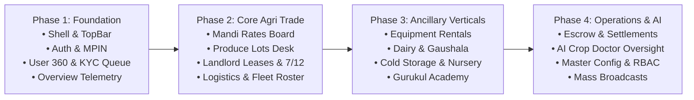

# AGROVERCITY Superadmin Web Application — Architecture & Feature Analysis

> **Target Application**: AGROVERCITY (Kisan Setu) Superadmin Webapp  
> **Referenced Project**: [`AGROVERCITY_05_10_2026`](file:///root/Agrovercity_project/AGROVERCITY_05_10_2026)  
> **Source Architecture Summary**: [`website_summary.md`](file:///root/Agrovercity_project/website_summary.md)  
> **Date**: November 2026  
> **Status**: Approved Architectural Blueprint  

---

## 1. Executive Summary & Governance Role

**AGROVERCITY (Kisan Setu)** is a comprehensive multi-sided agricultural technology ecosystem connecting **13+ distinct rural personas** (Farmers, Landlords, Mandi Vyaparis, Transporters, Equipment Owners, Exporters, Bulk Industrial Buyers, Milk Vendors, Plant Nurseries, Gaushalas, Cold Storage Providers, and Gurukul Academies).

The **Superadmin Web Application** serves as the central command, operational governance, audit compliance, and financial reconciliation cockpit. It connects directly to the FastAPI backend (130+ domain routers) and Google Cloud Firestore database with zero mock data.

### Core Governance Principles
1. **Rule 8 Immutable Audit Enforcement**: All state mutations (KYC approvals, account suspensions, price overrides, wallet balance adjustments, dispute resolutions) require mandatory operator remarks written directly into the `audit_logs` collection.
2. **Direct-Connect & Contact Masking Audit**: The platform strictly masks bilateral phone/WhatsApp contacts until both parties mutually accept an interest request. Superadmin oversees and audits these unlocked connections.
3. **Omni-Persona Oversight**: Single user identities can hold multiple personas. Superadmin provides a unified 360° view of any user across all their agricultural activities.

---

## 2. High-Level System Architecture & Webpage Inventory

```mermaid
flowchart TD
    SA["Superadmin Web Application\n(Port 5174 / 5175)"]
    
    SA --> M1["1. Auth & Security (2 Pages)"]
    SA --> M2["2. Executive Command & Telemetry (2 Pages)"]
    SA --> M3["3. User 360 & KYC Verification (4 Pages)"]
    SA --> M4["4. Trade, Mandi & Commerce Desk (5 Pages)"]
    SA --> M5["5. Farmland & Landlord Desk (3 Pages)"]
    SA --> M6["6. Logistics & Fleet Desk (3 Pages)"]
    SA --> M7["7. Machinery & Equipment Hire (3 Pages)"]
    SA --> M8["8. Dairy, Milk & Gaushala Hub (3 Pages)"]
    SA --> M9["9. Storage, Warehousing & Nursery (3 Pages)"]
    SA --> M10["10. Gurukul Academy & CMS (3 Pages)"]
    SA --> M11["11. Finance, Escrow & Settlements (3 Pages)"]
    SA --> M12["12. AI Crop Doctor & Chatbot Ops (2 Pages)"]
    SA --> M13["13. System Master Config & RBAC (2 Pages)"]
```

### Webpage Distribution Summary

| Module ID | Functional Area | Webpages | Key Personas & Entities Governed |
|---|---|:---:|---|
| **01** | **Authentication & Security** | 2 | Platform Operators, Root Superadmins |
| **02** | **Executive Telemetry & KPI Wall** | 2 | Ecosystem Health, API Latency, Firestore Usage |
| **03** | **User 360° & KYC Governance** | 4 | All 13 Personas, Digilocker/Aadhaar Submissions |
| **04** | **Trade, Mandi & Commerce Desk** | 5 | Farmers, Mandi Traders, Exporters, Bulk Buyers |
| **05** | **Farmland & Landlord Desk** | 3 | Farmland Owners, Tenant Cultivators, 7/12 Records |
| **06** | **Logistics & Fleet Transport** | 3 | Transporters, Fleet Drivers, Cargo Shipments |
| **07** | **Machinery & Yantra Rentals** | 3 | Equipment Owners, Harvester Operators, CHCs |
| **08** | **Dairy, Milk & Gaushala Hub** | 3 | Milk Vendors (Doodh Vala), Gaushalas, Vets |
| **09** | **Warehousing & Plant Nurseries** | 3 | Cold Storage Providers, Plant Nurseries, Agroforestry |
| **10** | **Gurukul Academy & CMS** | 3 | Instructors, Students, Agri News Readers |
| **11** | **Financials, Escrow & Settlements** | 3 | Bank Accounts, Escrow Payouts, Kisan Coins |
| **12** | **AI Agronomist & Chatbot Ops** | 2 | Gemini AI Crop Doctor, Chatbot Transcripts, Human Handoffs |
| **13** | **System Master Data & RBAC** | 2 | Admin Operators, Feature Flags, System Settings |
| **TOTAL** | **13 Core Modules** | **38 Pages** | **Complete Ecosystem Coverage** |

---

## 3. Detailed Specifications by Module & Webpage

### Module 01: Authentication & Operator Access Security (2 Pages)

#### Webpage 1: Login & Identity Gateway
* **Route**: `/login`
* **Target Audience**: Platform Operators, Field Officers, Superadmins.
* **Features & Capabilities**:
  * Phone number + Admin password / Secure MPIN credentials.
  * Role detection and session duration selector (Standard vs Privileged 4-hour window).
  * Rate-limiting indicator with IP freeze lockout protection.
  * Operational status indicator for backend and database connectivity.
* **Backend Routers**: [`backend/app/routers/auth.py`](file:///root/Agrovercity_project/AGROVERCITY_05_10_2026/backend/app/routers/auth.py).

#### Webpage 2: MPIN Step-Up Verification
* **Route**: `/verify-mpin`
* **Target Audience**: Active operators performing high-privilege operations.
* **Features & Capabilities**:
  * Numeric 4-digit / 6-digit MPIN step-up verification modal/screen.
  * Required before executing high-impact actions: user banning, manual wallet debit, mass broadcast, or payout releases.
  * Auto-timeout after 3 failed attempts with audit log flagging.
* **Backend Routers**: [`POST /admin/verify-mpin`](file:///root/Agrovercity_project/AGROVERCITY_05_10_2026/backend/app/routers/admin.py).

---

### Module 02: Executive Command & Telemetry Wall (2 Pages)

#### Webpage 3: Platform Overview & Pulse Wall
* **Route**: `/overview` (or `/`)
* **Target Audience**: Executive Leadership, Operations Managers.
* **Features & Capabilities**:
  * **Top Metrics**: Total Registered Users, Active Farm Acres, Live Trade Lots, Active Fleet Dispatches, Daily Gross Merchandise Value (GMV).
  * **Ecosystem Heatmap**: District-wise activity across Maharashtra / pan-India APMC clusters.
  * **Urgent Attention Counters**: Pending KYC submissions, Flagged Mandi Rates, Stalled Logistics Dispatches, Unresolved Disputes.
  * **Real-time Server & DB Health**: Firestore document read/write delta telemetry, Redis cache hit ratio, Gemini API quota status.
* **Backend Routers**: [`GET /v1/admin/overview`](file:///root/Agrovercity_project/AGROVERCITY_05_10_2026/backend/app/routers/admin.py).

#### Webpage 4: Real-time Activity Telemetry Feed
* **Route**: `/telemetry`
* **Target Audience**: Operations Duty Officers, System Auditors.
* **Features & Capabilities**:
  * Streaming event ticker (User logins, Direct-Connect reveals, Lot listings, Bilty notes generated).
  * Filter by persona, district, or severity level (`INFO`, `WARNING`, `CRITICAL`).
  * 1-click drilldown into entity or actor drawer.
* **Backend Routers**: [`GET /admin/audit`](file:///root/Agrovercity_project/AGROVERCITY_05_10_2026/backend/app/routers/admin.py).

---

### Module 03: User 360° Management & KYC Governance (4 Pages)

#### Webpage 5: Master User Directory
* **Route**: `/users`
* **Target Audience**: User Operations, KYC Agents, Risk Officers.
* **Features & Capabilities**:
  * Search by Phone, Full Name, User ID (UID), District, or Persona tag.
  * Datetime range filters: `All Time`, `Today`, `Last 7 Days`, `Last 30 Days`, custom ISO datetime picker.
  * Sort order: Recent entered users first (descending `createdAt`).
  * Account Status toggles (`ACTIVE`, `SUSPENDED`, `BANNED`).
  * Instant CSV / JSON export of filtered user directories.
  * Direct Admin User Creation modal (pre-assigning persona and initial status).
* **Backend Routers**: [`GET /api/v1/admin/users`](file:///root/Agrovercity_project/AGROVERCITY_05_10_2026/backend/app/routers/admin_sop_users.py).

#### Webpage 6: User 360° Profile & Governance Drawer
* **Route**: `/users/:id`
* **Target Audience**: Operations Officers handling deep user investigation.
* **Features & Capabilities**:
  * **Tab 1 - Identity & KYC**: Profile avatar, bio, verified phone, address, linked bank account (penny drop status), zoomable Aadhaar/7-12 documents, manual approve/reject override with mandatory remarks.
  * **Tab 2 - Telemetry & Sessions**: Chronological activity trail, active JWT tokens counter, 1-click session revocation, login IP history.
  * **Tab 3 - Associated Content**: All produce lots, mandi bids, transport bookings, reviews, and media uploaded by this user, with 1-click moderation/takedown.
  * **Tab 4 - Financials & Security**: Account status toggle, 15-minute scoped impersonation token generator, manual wallet adjustment (Credit/Debit), and GDPR dossier export.
* **Backend Routers**: [`GET /admin/users/{id}/summary`](file:///root/Agrovercity_project/AGROVERCITY_05_10_2026/backend/app/routers/admin_sop_users.py).

#### Webpage 7: Central KYC & Identity Verification Queue
* **Route**: `/kyc`
* **Target Audience**: KYC Compliance Officers.
* **Features & Capabilities**:
  * Split screen view: Document image (side-by-side) vs OCR extracted data.
  * Verification triage: `Approve`, `Reject with Reason`, `Request Higher Resolution Document`.
  * Mock DigiLocker match score inspection.
  * Bulk verification capabilities for verified district batches.
* **Backend Routers**: [`GET /admin/kyc/queue`](file:///root/Agrovercity_project/AGROVERCITY_05_10_2026/backend/app/routers/admin.py), [`POST /admin/kyc/{id}/verify`](file:///root/Agrovercity_project/AGROVERCITY_05_10_2026/backend/app/routers/admin.py).

#### Webpage 8: Farmer Specific Operations & Diary Audit
* **Route**: `/farmers`
* **Target Audience**: Agricultural Agronomists, Farmer Support Officers.
* **Features & Capabilities**:
  * Acreage breakdown (Rainfed vs Irrigated land).
  * Farm Diary activity feed (sowing, fertilizer spray, harvest logs).
  * Profit & Loss statement auditor per farmer crop cycle.
  * Tree plantation verification and gamified Kisan Coin balance audit.
* **Backend Routers**: [`backend/app/routers/admin_sop_farmers.py`](file:///root/Agrovercity_project/AGROVERCITY_05_10_2026/backend/app/routers/admin_sop_farmers.py).

---

### Module 04: Agricultural Trade, Mandi & Commerce Desk (5 Pages)

#### Webpage 9: Live Mandi Rates & APMC Board
* **Route**: `/trade/mandi`
* **Target Audience**: Mandi Arbitrators, Price Desk Officers.
* **Features & Capabilities**:
  * District & commodity price matrix (Min, Max, Modal prices).
  * Flagged rate moderation queue: Detects anomalies (e.g. onion price entered 10x market standard).
  * 1-click APMC price sync trigger with national portals.
* **Backend Routers**: [`GET /admin/mandi/rates`](file:///root/Agrovercity_project/AGROVERCITY_05_10_2026/backend/app/routers/admin_console.py), [`POST /admin/mandi/rates/{id}/approve`](file:///root/Agrovercity_project/AGROVERCITY_05_10_2026/backend/app/routers/admin_console.py).

#### Webpage 10: Farm-Gate Produce Lots Directory
* **Route**: `/trade/lots`
* **Target Audience**: Commodity Verification Officers.
* **Features & Capabilities**:
  * Listing status filters (`ACTIVE`, `SOLD`, `EXPIRED`, `REPORTED`).
  * Quality parameters inspection (Moisture content, Crop Grade, Harvest date, Batch images).
  * Moderation takedown for suspicious or adulterated lot listings.
* **Backend Routers**: [`GET /admin/lots`](file:///root/Agrovercity_project/AGROVERCITY_05_10_2026/backend/app/routers/admin_console.py).

#### Webpage 11: B2B Vyapari & Buyer Demands Desk
* **Route**: `/trade/demands`
* **Target Audience**: B2B Sourcing Managers.
* **Features & Capabilities**:
  * Corporate buyer requirement approval (Tonnage, quality specs, delivery target date).
  * Track farmer supply applications submitted against procurement demands.
  * Direct-Connect unlock audit: View which farmers revealed contacts to which buyers.
* **Backend Routers**: [`backend/app/routers/admin_sop_trade.py`](file:///root/Agrovercity_project/AGROVERCITY_05_10_2026/backend/app/routers/admin_sop_trade.py).

#### Webpage 12: Agri Exporter & Global RFQs Desk
* **Route**: `/trade/export`
* **Target Audience**: Export Trade Compliance Managers.
* **Features & Capabilities**:
  * Exporter accreditation and license verification (APEDA, FSSAI, GlobalGAP).
  * Export RFQ monitoring with export standard limits (MRL / pesticide residue tolerances).
  * Farmer laboratory test report compliance verification.
* **Backend Routers**: [`backend/app/routers/exporter.py`](file:///root/Agrovercity_project/AGROVERCITY_05_10_2026/backend/app/routers/exporter.py).

#### Webpage 13: Krishi Mall E-Commerce & Marketplace Governance
* **Route**: `/trade/mall`
* **Target Audience**: Marketplace Operations, Merchant Managers.
* **Features & Capabilities**:
  * Product catalog approval, pricing overrides, and banned pesticide checks.
  * Customer order tracking, fulfillment status, and refund approval modal.
  * Seller commission rules configuration.
* **Backend Routers**: [`GET /admin/marketplace/orders`](file:///root/Agrovercity_project/AGROVERCITY_05_10_2026/backend/app/routers/admin_sop_trade.py).

---

### Module 05: Farmland & Landlord Desk (3 Pages)

#### Webpage 14: Land Lease Listings & Parcels Desk
* **Route**: `/land/parcels`
* **Target Audience**: Land Operations Officers.
* **Features & Capabilities**:
  * Filter by Soil Type (Black Cotton, Loamy, Red), Irrigation source (Well, Canal, Borewell), and Lease Terms.
  * Listing status and direct lease rent verification.
  * Land title photo and boundary survey verification.
* **Backend Routers**: [`GET /admin/land/leases`](file:///root/Agrovercity_project/AGROVERCITY_05_10_2026/backend/app/routers/admin_console.py).

#### Webpage 15: 7/12 Land Records & Survey Verification
* **Route**: `/land/712-records`
* **Target Audience**: Land Title Officers.
* **Features & Capabilities**:
  * Verification status: Match recorded owner name with user identity.
  * Seed mock/live land records for test environments.
  * Disputed land tag: Freeze parcel leasing if ownership dispute exists.
* **Backend Routers**: [`GET /admin/land-records/status`](file:///root/Agrovercity_project/AGROVERCITY_05_10_2026/backend/app/routers/admin_sop_finance.py).

#### Webpage 16: Lease Agreements & Direct Connections Desk
* **Route**: `/land/leases`
* **Target Audience**: Lease Contract Managers.
* **Features & Capabilities**:
  * View negotiated lease terms, security deposits, and contract durations.
  * Contact reveal audit (phone/WhatsApp unmasking timestamps).
  * Dispute resolution trigger for breached tenancy conditions.
* **Backend Routers**: [`backend/app/routers/land_ops.py`](file:///root/Agrovercity_project/AGROVERCITY_05_10_2026/backend/app/routers/land_ops.py).

---

### Module 06: Logistics, Transporter & Fleet Desk (3 Pages)

#### Webpage 17: Fleet & Vehicle Roster Verification
* **Route**: `/logistics/fleet`
* **Target Audience**: Transport Fleet Officers.
* **Features & Capabilities**:
  * Vehicle documentation checks: RC Book, Commercial Permit, Fitness Certificate, Transit Insurance.
  * Verification status toggles (`VERIFIED`, `PENDING_DOCS`, `BLACKLISTED`).
  * Vehicle type classification (Bolero Maxi Truck, 14-ft Eicher, 10-Wheeler, Tractor Trolley).
* **Backend Routers**: [`POST /admin/transport/vehicles/{id}/verify`](file:///root/Agrovercity_project/AGROVERCITY_05_10_2026/backend/app/routers/admin_console.py).

#### Webpage 18: Dispatch Operations & Live Trips
* **Route**: `/logistics/trips`
* **Target Audience**: Dispatch Controllers.
* **Features & Capabilities**:
  * Trip lifecycle tracking: `Pending Pickup` → `Goods Loaded` → `In Transit` → `Delivered`.
  * Digital Bilty (consignment note) inspection and PDF download.
  * Freight charges and distance calculation audit.
* **Backend Routers**: [`backend/app/routers/admin_sop_logistics.py`](file:///root/Agrovercity_project/AGROVERCITY_05_10_2026/backend/app/routers/admin_sop_logistics.py).

#### Webpage 19: Freight Pricing Rules & Pickup Exceptions
* **Route**: `/logistics/config`
* **Target Audience**: Logistics Policy Administrators.
* **Features & Capabilities**:
  * Per-kilometer baseline rate limits per vehicle type.
  * Grace-window management for delayed pickups.
  * Transporter suspension / penalty management for rejected confirmed loads.
* **Backend Routers**: [`GET /admin/platform-config/grace-window`](file:///root/Agrovercity_project/AGROVERCITY_05_10_2026/backend/app/routers/admin_sop_logistics.py).

---

### Module 07: Machinery, Implements & Rental Desk (3 Pages)

#### Webpage 20: Agricultural Machinery Inventory
* **Route**: `/machinery/inventory`
* **Target Audience**: Equipment Operations Officers.
* **Features & Capabilities**:
  * Machinery classifications: Tractors, Combine Harvesters, Rotavators, Laser Levelers, Drone Sprayers.
  * Hourly / Daily rental rate sanity checks.
  * Equipment ownership documents and maintenance compliance verification.
* **Backend Routers**: [`GET /admin/equipment`](file:///root/Agrovercity_project/AGROVERCITY_05_10_2026/backend/app/routers/admin_console.py).

#### Webpage 21: Equipment Bookings & Dispatch Schedule
* **Route**: `/machinery/bookings`
* **Target Audience**: Rental Schedulers.
* **Features & Capabilities**:
  * Active bookings calendar and dispatch statuses (`CONFIRMED`, `EN_ROUTE`, `WORKING`, `COMPLETED`).
  * Escalation handling for equipment breakdown during critical sowing/harvest windows.
* **Backend Routers**: [`POST /admin/equipment/bookings/{id}/escalate`](file:///root/Agrovercity_project/AGROVERCITY_05_10_2026/backend/app/routers/admin_console.py).

#### Webpage 22: Drone Spraying & Custom Hiring Centers (CHC)
* **Route**: `/machinery/chc`
* **Target Audience**: Advanced Agri-tech Officers.
* **Features & Capabilities**:
  * Drone pilot DGCA license verification.
  * Spraying job safety audits and chemical formulation approvals.
* **Backend Routers**: [`backend/app/routers/equipment_rental.py`](file:///root/Agrovercity_project/AGROVERCITY_05_10_2026/backend/app/routers/equipment_rental.py).

---

### Module 08: Dairy, Milk Vendors & Gaushala Sanctuary (3 Pages)

#### Webpage 23: Milk Vendor (Doodh Vala) Ledger Desk
* **Route**: `/dairy/vendors`
* **Target Audience**: Dairy Operations Officers.
* **Features & Capabilities**:
  * Daily delivery logs (Cow vs Buffalo milk liters delivered).
  * Rate per liter audit against state cooperative baselines.
  * Public bill token verification (inspecting customer web invoices `/public/milk-bills/:token`).
* **Backend Routers**: [`backend/app/routers/milk_seller.py`](file:///root/Agrovercity_project/AGROVERCITY_05_10_2026/backend/app/routers/milk_seller.py).

#### Webpage 24: Gaushala & Animal Welfare Directory
* **Route**: `/dairy/gaushalas`
* **Target Audience**: Livestock Welfare Officers.
* **Features & Capabilities**:
  * Cattle census (Cows, Bulls, Calves registered with tag numbers).
  * Public donation receipts and cow adoption (Gau Seva) audit.
  * Feed subsidy and municipal grant tracking.
* **Backend Routers**: [`GET /admin/gaushalas`](file:///root/Agrovercity_project/AGROVERCITY_05_10_2026/backend/app/routers/admin_console.py).

#### Webpage 25: Veterinary Network & Animal Health Camps
* **Route**: `/dairy/vets`
* **Target Audience**: Animal Health Coordinators.
* **Features & Capabilities**:
  * Veterinary degree and state council registration verification.
  * Vaccination drive scheduling (Foot & Mouth disease, Lumpy Skin).
* **Backend Routers**: [`POST /admin/vets/{id}/verify`](file:///root/Agrovercity_project/AGROVERCITY_05_10_2026/backend/app/routers/admin_console.py).

---

### Module 09: Cold Storage, Warehousing & Nursery (3 Pages)

#### Webpage 26: Cold Storage Facilities Management
* **Route**: `/warehousing/cold-storage`
* **Target Audience**: Warehousing Compliance Officers.
* **Features & Capabilities**:
  * Facility registration (Chambers, temperature zones, storage capacity in metric tons).
  * Chamber verification (Potato, Onion, Fruit chillers).
  * Electronic Warehouse Receipts (e-NWR) audit for produce pledged for bank loans.
* **Backend Routers**: [`GET /admin/cold-storages`](file:///root/Agrovercity_project/AGROVERCITY_05_10_2026/backend/app/routers/admin_console.py).

#### Webpage 27: Plant Nurseries & Sapling Inventory
* **Route**: `/warehousing/nurseries`
* **Target Audience**: Horticulture Officers.
* **Features & Capabilities**:
  * Sapling catalog review (Fruit grafts, vegetable seedlings, forestry trees).
  * Nursery phytosanitary accreditation verification.
  * Farmer sapling subsidy distribution tracking.
* **Backend Routers**: [`GET /admin/nurseries`](file:///root/Agrovercity_project/AGROVERCITY_05_10_2026/backend/app/routers/admin_console.py).

#### Webpage 28: Agroforestry & Tree Plantation Verifier
* **Route**: `/warehousing/agroforestry`
* **Target Audience**: Agroforestry & Sustainability Officers.
* **Features & Capabilities**:
  * Geo-tagged farmer tree plantation verification photos.
  * Carbon audit metrics and NGO partner verifications.
  * Gamified coin crediting upon tree survival milestones.
* **Backend Routers**: [`PUT /admin/farmers/{id}/trees/{tree_id}/verify`](file:///root/Agrovercity_project/AGROVERCITY_05_10_2026/backend/app/routers/admin_sop_farmers.py).

---

### Module 10: Gurukul Academy & Content CMS (3 Pages)

#### Webpage 29: Course Catalog & Instructor Studio Desk
* **Route**: `/gurukul/courses`
* **Target Audience**: Education Program Managers.
* **Features & Capabilities**:
  * Course curriculum review (Lessons, video uploads, quiz evaluations).
  * Instructor ICAR / Agri-University credentials verification.
  * Course feature toggle on mobile homepage.
* **Backend Routers**: [`GET /admin/courses/queue`](file:///root/Agrovercity_project/AGROVERCITY_05_10_2026/backend/app/routers/admin.py).

#### Webpage 30: Agricultural News & Video Channels CMS
* **Route**: `/cms/news-media`
* **Target Audience**: Content Editors, Community Moderators.
* **Features & Capabilities**:
  * Bilingual article editor (English & Marathi).
  * Urgent alert banner scheduler (e.g. Locust warnings, Unseasonal hailstorm alerts).
  * Community comments moderation queue.
* **Backend Routers**: [`GET /admin/content/news`](file:///root/Agrovercity_project/AGROVERCITY_05_10_2026/backend/app/routers/admin_console.py).

#### Webpage 31: Government Schemes & Subsidies Directory
* **Route**: `/cms/schemes`
* **Target Audience**: Public Policy Officers.
* **Features & Capabilities**:
  * Scheme eligibility rules engine (PM-Kisan, drip irrigation subsidies, tractor subsidies).
  * Application document checklists and direct portal links.
  * Farmer assistance ticket desk for application help.
* **Backend Routers**: [`backend/app/routers/schemes.py`](file:///root/Agrovercity_project/AGROVERCITY_05_10_2026/backend/app/routers/schemes.py).

---

### Module 11: Financial Operations, Escrow & Settlements (3 Pages)

#### Webpage 32: Bank Account Verification & Penny-Drop Overrides
* **Route**: `/finance/bank-accounts`
* **Target Audience**: Settlement Officers, Banking Operations.
* **Features & Capabilities**:
  * Penny-drop verification results (Name match confidence score, IFSC validation).
  * Manual bank override button with document attachment.
  * Fraudulent account flagging.
* **Backend Routers**: [`POST /admin/finance/bank-accounts/{id}/override-verify`](file:///root/Agrovercity_project/AGROVERCITY_05_10_2026/backend/app/routers/admin_console.py).

#### Webpage 33: Escrow Holdings & Trade Settlements
* **Route**: `/finance/settlements`
* **Target Audience**: Chief Financial Officer, Trade Settlement Desk.
* **Features & Capabilities**:
  * Escrow account ledger for high-value B2B commodity trades.
  * Payout release triggers (Post-delivery confirmation).
  * Manual settlement batch run button (`POST /admin/jobs/settlements/run`).
* **Backend Routers**: [`GET /admin/settlements`](file:///root/Agrovercity_project/AGROVERCITY_05_10_2026/backend/app/routers/admin_console.py).

#### Webpage 34: Kisan Coins Ledger & Gamification Economy
* **Route**: `/finance/coins`
* **Target Audience**: Growth Managers, Economy Analysts.
* **Features & Capabilities**:
  * Total Kisan Coins in circulation vs redemption burn rate.
  * Referral fraud detection: Flags multiple signups from the same IP/Device ID.
  * Manual coin adjustments (Credit/Debit incentive coins).
* **Backend Routers**: [`GET /admin/gamification/circulation`](file:///root/Agrovercity_project/AGROVERCITY_05_10_2026/backend/app/routers/admin_console.py).

---

### Module 12: AI Agronomist & Chatbot Operations (2 Pages)

#### Webpage 35: AI Crop Doctor & Agronomist Telemetry
* **Route**: `/ai-ops/crop-doctor`
* **Target Audience**: Certified Agronomists, AI System Engineers.
* **Features & Capabilities**:
  * Scan gallery: Farmer uploaded plant disease images vs Gemini diagnosis.
  * Agronomist accuracy score override: Human expert validates or corrects AI diagnostic.
  * Model latency and token usage monitoring.
* **Backend Routers**: [`GET /admin/advisory/scans/accuracy`](file:///root/Agrovercity_project/AGROVERCITY_05_10_2026/backend/app/routers/admin_console.py).

#### Webpage 36: Chatbot Sessions & Human Expert Handoffs
* **Route**: `/ai-ops/chat-handoffs`
* **Target Audience**: Support Agronomists, Helpdesk Agents.
* **Features & Capabilities**:
  * Live chatbot conversation transcripts viewer.
  * Human expert escalation queue: Assign unhandled agronomy queries to certified agronomists.
  * System prompt tuning and intent overrides.
* **Backend Routers**: [`GET /admin/chatbot/sessions`](file:///root/Agrovercity_project/AGROVERCITY_05_10_2026/backend/app/routers/admin_console.py), [`POST /admin/expert-handoffs/{id}/resolve`](file:///root/Agrovercity_project/AGROVERCITY_05_10_2026/backend/app/routers/admin.py).

---

### Module 13: Platform Master Config, Security & RBAC (2 Pages)

#### Webpage 37: Operator RBAC & Audit Trail
* **Route**: `/system/rbac-audit`
* **Target Audience**: Chief Security Officer, Superadmin Administrators.
* **Features & Capabilities**:
  * Admin team roster (Superadmin, KYC Officer, Trade Desk Manager, Logistics Dispatcher, Dispute Arbitrator).
  * Role permissions assignment matrix.
  * Immutable Audit Log: Timestamp, Operator ID, Target Entity, Action, and mandatory Reason text.
* **Backend Routers**: [`GET /admin/audit`](file:///root/Agrovercity_project/AGROVERCITY_05_10_2026/backend/app/routers/admin.py).

#### Webpage 38: Platform Master Data & Feature Flags
* **Route**: `/system/settings`
* **Target Audience**: Lead Platform Engineers, Superadmins.
* **Features & Capabilities**:
  * Master collections: APMC commodity varieties, crop stages, districts, units of measurement.
  * Feature Flags: Toggle modules (e.g. enable/disable Export RFQ desk or AI Crop Doctor).
  * System-wide notification broadcast composer (Push notification & SMS).
  * Partner API key management and rate limit quotas.
* **Backend Routers**: [`GET /admin/app-config`](file:///root/Agrovercity_project/AGROVERCITY_05_10_2026/backend/app/routers/admin.py), [`POST /admin/broadcasts`](file:///root/Agrovercity_project/AGROVERCITY_05_10_2026/backend/app/routers/admin.py).

---

## 4. Phased Implementation Roadmap

When proceeding to development, the implementation should follow this 4-phase rollout to maximize platform stability:

1. **Phase 1 — Core Foundation & Governance Engine (Pages 1–8)**:
   - Establish App layout, TopBar, Sidebar, and AuthContext.
   - Implement User 360° Directory and 4-tab Drawer.
   - Implement KYC Review Queue with DigiLocker preview.
   - Implement Executive Overview Telemetry Wall.

2. **Phase 2 — Direct-Connect Trade, Land & Logistics (Pages 9–19)**:
   - Implement Mandi Price Board with APMC sync.
   - Implement Produce Lots & Buyer Demands desks.
   - Implement Land parcels, 7/12 records, and lease contracts.
   - Implement Transporter fleet verification, live dispatch trips, and digital Bilty generator.

3. **Phase 3 — Extended Personas & Rural Verticals (Pages 20–31)**:
   - Implement Machinery & Custom Hiring Centers (CHC).
   - Implement Dairy milk delivery ledger, Gaushala animal directory, and vet verification.
   - Implement Cold storage facilities and nursery saplings.
   - Implement Gurukul Academy and News/Schemes CMS.

4. **Phase 4 — Financials, AI Operations & Platform Controls (Pages 32–38)**:
   - Implement Bank account verification and Escrow settlement batch runner.
   - Implement AI Crop Doctor accuracy oversight and Chatbot transcripts.
   - Implement RBAC operator policy and Platform Feature Flags.
