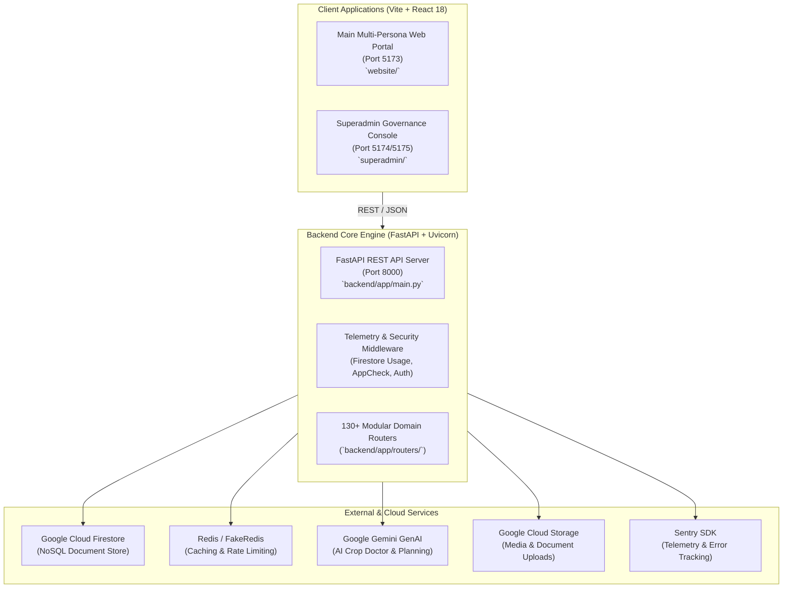

# AGROVERCITY (Kisan Setu) — Whole Project & Website Architecture Summary

> **Referenced Project Directory**: [`AGROVERCITY_05_10_2026`](file:///root/Agrovercity_project/AGROVERCITY_05_10_2026)  
> **Target Application**: AGROVERCITY Ecosystem Platform (Web App, Backend REST API, Superadmin Console, Simulation & Test Suites)  
> **Date**: November 2026  
> **Status**: Active / Production-Ready  

---

## 1. Executive Summary & Purpose

**AGROVERCITY** (also branded as **Kisan Setu / किसान सेतू**) is a full-stack, multi-sided agricultural technology ecosystem designed to digitize and connect India's rural agricultural economy. It links farmers directly with agricultural landlords, mandi traders (vyaparis), commercial equipment owners, logistics transporters, industrial bulk buyers, international agri-exporters, local milk vendors, plant nurseries, gaushalas, cold storage providers, and agricultural academies.

The platform eliminates exploitative middlemen by enabling transparent **Direct-Connect** matchmaking, phone/WhatsApp contact reveals upon mutual interest acceptance, localized language support (English and Marathi), AI-powered agronomist & disease detection capabilities, and integrated transactional tooling.

---

## 2. System Architecture & High-Level Topology

---

## 3. Technology Stack Breakdown

| Component | Technologies & Libraries | Port / Path |
|---|---|---|
| **Website Frontend** | React 18, TypeScript 5.6, Vite 5.4, Tailwind CSS 3.4, Zustand (state store), React Router v6, Lucide React (icons), Recharts (data viz), Axios, QRCode | Port 5173 (`website/`) |
| **Superadmin Portal** | React 18, TypeScript, Vite, Tailwind CSS, Lucide React, Axios | Port 5174 / 5175 (`superadmin/`) |
| **Backend REST API** | Python 3.11+, FastAPI 0.115+, Uvicorn, Pydantic Settings, Firebase Admin SDK 6.5+, Pytest, ReportLab (PDFs), Pillow | Port 8000 (`backend/`) |
| **Database & Cache** | Google Cloud Firestore (primary document database), Redis 5.0+ / fakeredis | Cloud Firestore |
| **AI / Machine Learning** | Google GenAI SDK (`google-genai>=2.0.0`) Gemini models for Crop Doctor, AI Agronomist, and Crop Planning | Cloud API |
| **Orchestration & DevOps** | Bash process supervisor scripts (`run.sh`, `install.sh`) with process group cleanup and early failure detection | Root directory |
| **Testing & Simulation** | Playwright E2E suites (`playwright-scripts/`, `e2e/`), Pytest backend suites (`backend/tests/`), Sim traffic engine (`sim/`) | Automation |

---

## 4. Platform Personas & Feature Workspaces

AGROVERCITY supports dynamic multi-persona profiles under a single user identity. Users can switch personas or hold linked roles:

### 4.1. Farmer / Kisan Hub (`/farmer`)
The farmer's digital cockpit with bilingual UI (English / Marathi) covering the entire cultivation and trade lifecycle:
- **Trade & Direct Selling**:
  - **My Produce Lots (`/farmer/lots`)**: Create crop sale listings with grade, moisture, harvest date, and expected price.
  - **Post to Buyers (`/farmer/post-to-buyers`)**: Direct produce broadcasting to registered vyaparis and industrial buyers.
  - **Mandi Prices (`/farmer/mandi`)**: Live APMC market price discovery across commodities and districts.
  - **Buyer Demands & Industry (`/farmer/demands`)**: Browse industrial procurement requirements and apply directly.
  - **Farmland Leasing (`/farmer/land`)**: Search available lease plots or post requirements for agricultural land.
  - **Agri Export (`/farmer/export`)**: Browse exporter RFQs, submit farmer supply applications, and verify export readiness.
  - **My Connections (`/farmer/connections`)**: Unified view of accepted trade leads and bilateral farmer ↔ landlord lease connections.
- **Kisan Core & Agronomy**:
  - **Farmer Cockpit (`/farmer`)**: Quick action widgets, weather alerts, urgent tasks, and telemetry.
  - **My Crops (`/farmer/crops`)**: Crop cycle and acreage tracker.
  - **AI Crop Doctor (`/farmer/crop-doctor`)**: Image-based crop disease diagnosis using Gemini AI.
  - **AI Crop Plan (`/farmer/crop-plan`)**: Stage-by-stage planting and advisory planner.
  - **Farm Diary (`/farmer/diary`)**: Daily agricultural activity logging and expense tracking.
  - **Profit & Loss (`/farmer/pnl`)**: Financial accounting and crop cycle profitability.
  - **Rent Machinery (`/farmer/equipment`)**: Search and book local tractors, harvesters, and implements.
  - **Book Transport (`/farmer/transport`)**: On-demand truck/gadi booking for farm produce dispatch.
- **Finance, Land & Community**:
  - **Land Records (`/farmer/712`)**: Integrated 7/12 land record viewer and digital survey details.
  - **Government Schemes (`/farmer/schemes`)**: State and central agricultural subsidies and application guides.
  - **Weather & Water (`/farmer/water`)**: Real-time localized rainfall, temperature, and canal irrigation schedules.
  - **Kisan Coins (`/farmer/coins`)**: Gamified reward coins earned on platform milestones.
  - **Tree Plantation (`/community/trees`)**: Environmental agro-forestry and tree adoption tracking.
  - **Refer & Earn (`/farmer/referrals`)**: Peer referral program with bonus rewards.

### 4.2. Farm Landlord Hub (`/landlord`)
- **Direct Farmland Leasing**: List arable land plots with acreage, soil type, irrigation sources (well, bore, canal), and requested annual lease rent.
- **Verification**: Document submission and verification badge system for land parcels.
- **Interest Requests (`/landlord/requests`)**: Receive lease applications from local farmers; accept or decline with custom counter-offers.
- **My Connections / Leases (`/landlord/connections`)**: Direct contact reveal (phone & WhatsApp) upon bilateral agreement.

### 4.3. Transporter Logistics Hub (`/transporter`)
- **Load Board (`/transporter/loads`)**: Real-time marketplace of farmer and buyer cargo requests.
- **Trip Operations (`/transporter/trips`)**: Status tracking for active dispatches (Pending Pickup, En Route, Delivered).
- **Digital Bilty (`/transporter/bilty`)**: Waybills and digital consignment notes.
- **Fleet Management (`/transporter/fleet`)**: Vehicle roster (e.g., Bolero Maxi Truck, 14-ft Eicher, Tata Ace) with RC and insurance details.
- **Diary & Settlements**: Freight earnings ledger, trip expense logs, and shipper ratings.

### 4.4. Agri Vyapari / Trader (`/seller`)
- **Lot Discovery (`/seller/lots`)**: Search farm-gate produce lots filtered by commodity, district, and quantity.
- **Demands Manager (`/seller/demands`)**: Post purchase tenders for commodities needed at mandi or processing units.
- **Trade Connections (`/seller/connections`)**: Active farmer relationships with unlocked direct contact details.
- **Mandi Rate Board (`/seller/rates`)**: APMC price monitoring and market rate submissions.

### 4.5. Equipment Owner (`/equipment`)
- **Machines Inventory (`/equipment/machines`)**: Register tractors, combine harvesters, rotavators, sprayers, and laser levelers with hourly/daily rates.
- **Availability Calendar (`/equipment/availability`)**: Slot management and booking blockouts.
- **Booking Requests (`/equipment/requests`)**: Accept incoming farmer hire requests with custom rate adjustments.
- **Active Jobs (`/equipment/jobs`)**: Field dispatch tracking and completed job records.

### 4.6. Agri Exporter (`/exporter`)
- **Global RFQs (`/exporter/rfqs`)**: Post export orders specifying international quality standards (e.g., GlobalGAP, APEDA limits).
- **Farmer Applications (`/exporter/applications`)**: Review produce submissions and lab test certificates from farmers.
- **Export Connections (`/exporter/connections`)**: Established export supply pipelines.

### 4.7. Industrial / Direct Buyer (`/directbuyer`)
- **Bulk Requirements (`/directbuyer/requirements`)**: Post factory-grade purchase demands (e.g., 50 MT processing potatoes, sugar cane, maize).
- **Applications & Suppliers (`/directbuyer/applications`, `/directbuyer/suppliers`)**: Review farmer offers, negotiate contracts, and establish corporate direct-sourcing lines.

### 4.8. Milk Vendor / Doodh Vala (`/milkSeller`)
- **Daily Deliveries**: Morning and evening household milk delivery checklist (Cow / Buffalo milk litres).
- **Client Ledger**: Customer contact database with custom rate per litre and delivery preferences.
- **Invoicing & Public Bills**: Generate monthly delivery bills accessible by customers via secure, unauthenticated token links (`/public/milk-bills/:token`).

### 4.9. Plant Nursery (`/nursery`)
- **Inventory & Batches**: Catalog of fruit saplings, vegetable seedlings, and ornamental plants.
- **Batch Tracking**: Propagation age, health status, and ready-to-transplant timelines.
- **Customer Orders & Offers**: Direct nursery supply orders from farmers and horticulture enthusiasts.

### 4.10. Gaushala & Animal Sanctuary (`/gaushalaManager`)
- **Cattle Inventory**: Detailed records of sheltered cows, bulls, and calves (tag numbers, age, health condition).
- **Adoptions & Donations**: Manage community cow adoptions (Gau Seva) and donation receipts.
- **Veterinary Network**: Integration with local veterinary campaigns, deworming, and vaccination drives.

### 4.11. Cold Storage Provider (`/coldStorageProvider`)
- **Facility Management**: Cold room chambers, temperature zones (e.g., potato, onion, fruit chambers), and capacity utilization.
- **Bookings & Warehouse Receipts**: Issue digital warehouse receipts for stored produce batches.

### 4.12. Gurukul Academy (`/academy`)
- **Course Catalog & Player**: Agricultural courses on organic farming, drone spraying, greenhouse cultivation, and dairy management.
- **Instructor Studio**: Course builder, lesson content management, batch assignment, and digital certificate issuance.

### 4.13. Krishi Mall & Consumer Hub (`/mall`, `/customer`)
- **Agri Input Mall**: E-commerce shopping for seeds, fertilizers, organic pesticides, irrigation tools, and equipment.
- **Cart, Orders & Subscriptions**: Multi-item cart, tracking, recurring subscriptions, and wallet payments.

---

## 5. Cross-Persona Platform Services

1. **Authentication & Identity (`website/src/views/auth/`)**:
   - Phone + OTP / MPIN fast login.
   - 3-step registration wizard: Mobile Auth → Profile Creation → KYC Identity Check.
   - Mock DigiLocker integration for simulated Aadhaar verification.
2. **Omni-Channel Direct Chat (`/chat`)**:
   - In-app instant messaging connecting farmers, landlords, buyers, and transporters once connections are accepted.
3. **In-App Notifications (`/notifications`)**:
   - Real-time notifications for trade bids, booking confirmations, message alerts, and scheme updates.
4. **Gamification & Kisan Coins (`/farmer/coins`)**:
   - Engagement reward mechanism encouraging accurate diary entries, listing creations, and peer referrals.
5. **Localization & Language (`website/src/lib/i18n/`)**:
   - Dual English and Marathi UI strings across navigation, forms, alerts, and badges.

---

## 6. Backend API & Router Architecture

The FastAPI backend (`backend/app/main.py`) exposes over 130 routers structured into clear domain areas:

- **Auth & Account**: `auth`, `registration`, `users`, `kyc`, `bank_accounts`, `addresses`.
- **Agricultural Trade**: `lots`, `mandi`, `demands`, `leads`, `direct_buyer`, `exporter`, `contracts`, `orders`, `offers`, `price_alerts`.
- **Land & Machinery**: `land`, `land_ops`, `land_records`, `equipment`, `equipment_owner`, `equipment_rental`.
- **Logistics**: `transport`, `pickup`, `order_tracking`.
- **Dairy & Livestock**: `dairy_manager`, `dairy_hub`, `milk_seller`, `milk_vendor`, `livestock`, `livestock_dairy`, `livestock_gaushala`, `livestock_vets`.
- **Warehousing & Nursery**: `post_harvest`, `nursery`.
- **Agronomy & AI**: `advisory`, `ai_power`, `weather`, `water`, `soil_tests`, `specs`, `farmer_crops`, `tree`.
- **Education & Academy**: `courses`, `teachers`, `content`, `gyan`.
- **Commerce & Billing**: `marketplace`, `seller`, `seller_products`, `user_products`, `coupons`, `billing`, `settlements`, `pnl`, `gamification`, `referrals`.
- **Superadmin SOP Operations**: `admin`, `admin_console`, `admin_copilot`, `admin_sop_users`, `admin_sop_trade`, `admin_sop_farmers`, `admin_sop_finance`, `admin_sop_logistics`, `admin_sop_platform`, `admin_sop_org`, `admin_sop_economy`, `admin_sop_farm`, `admin_sop_chatbot`.

### Telemetry Middleware
`backend/app/main.py` incorporates a custom Firestore delta billing middleware that logs exact document reads and writes per API request, ensuring database cost control.

---

## 7. Superadmin Console (`superadmin/`)

The governance portal (accessible on Port 5174/5175) provides:
- **360° User Management**: Multi-persona filters, KYC status toggles, user blocking/activation, account export, and direct user creation.
- **Trade & Sourcing Audit**: Monitoring of active commodity lots, bulk industrial RFQs, and bilateral deals.
- **Landlord & Farmland Governance**: Land parcel verification checks and dispute audits.
- **RBAC & Admin Roles**: Role-based access control for operations staff.
- **Ecosystem KPIs**: Real-time counter metrics for total active users, registered acres, equipment fleet, and commodity turnover.

---

## 8. Test Suites & Quality Assurance

- **Playwright End-to-End (`playwright-scripts/`, `e2e/`)**: Comprehensive browser test scripts simulating farmer registration, produce listing creation, buyer demand applications, and landlord interest negotiations.
- **Backend Unit & Integration Tests (`backend/tests/`)**: High-coverage Pytest test suites validating route security, direct-connect permissions, contact masking rules, and transaction boundaries.
- **Simulation Engine (`sim/`)**: Workload generation scripts to simulate concurrent active users, APMC rate updates, and trade offers.

---

## 9. Recent Refinements & Architecture Decisions

1. **Direct-Connect Architecture**: Simplified negotiation workflows where contact numbers (phone/WhatsApp) remain strictly masked until both parties mutually accept an interest request.
2. **UI Simplification**: Removed legacy or rarely used front-end pages (e.g., KCC loans, complex bank vaults, carbon calculators) to streamline mobile-first user experience, while preserving backend API contracts intact for backward compatibility.
3. **Unified Navigation & Cross-Linking**: Farmland lease connections and trade leads are integrated directly into persona cockpits and symmetrical "My Connections" tabs.
